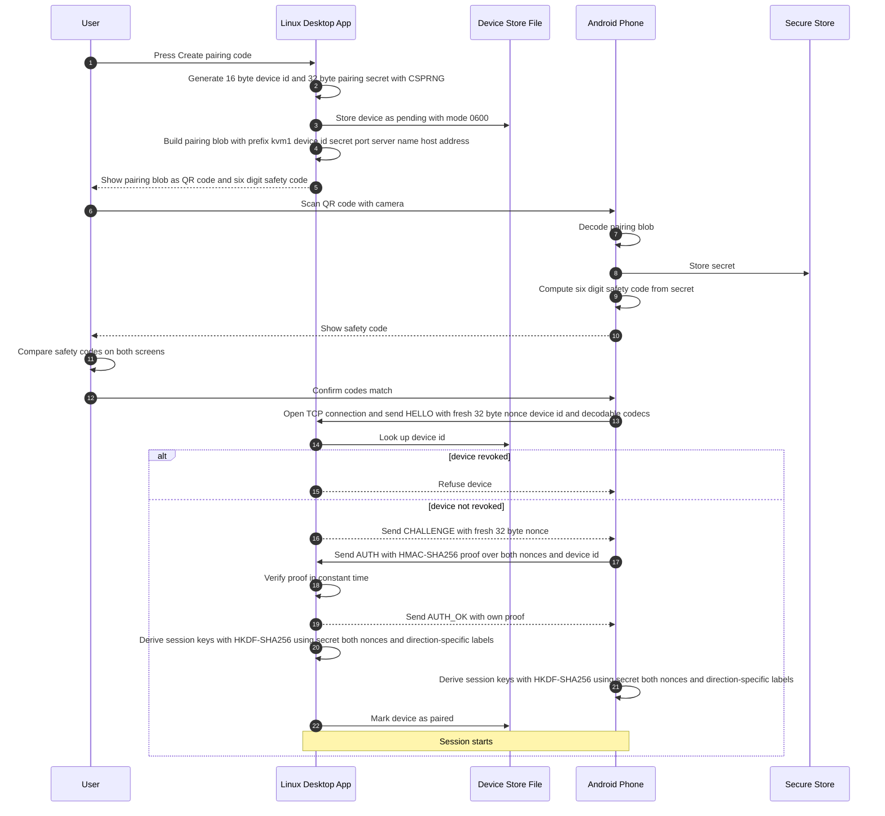
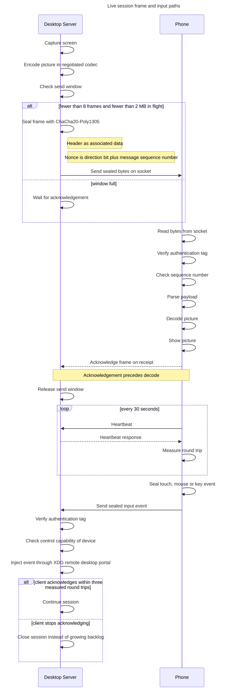

# The flows

The two moments that matter: pairing a phone, and a live session.

## Pairing

Pairing happens once per phone. The desktop creates a code, the phone scans
it, and the user confirms with a six digit safety code that both screens show
the same thing.

## A live session

The frame path, the window that keeps the sender busy, and the input path in
the other direction.

## The parts

```mermaid
flowchart TD
    subgraph Shared [Shared Protocol]
        RustCrate["Rust crate"]
        TSPackage["TypeScript package"]
        Golden["Golden vectors file"]
        Spec["Wire protocol specification"]
        RustCrate -->|checked against| Golden
        TSPackage -->|checked against| Golden
        Spec --> RustCrate
        Spec --> TSPackage
    end

    subgraph Desktop [Desktop App]
        Tauri["Tauri v2 application"]
        RustBackend["Rust backend"]
        TCPServer["TCP server"]
        Handshake["Handshake state machine"]
        Session["Session"]
        Sealed["Sealed channel"]
        Flow["Flow control window"]
        DeviceStore["Device store"]
        FrameSource["Frame source"]
        React["React interface with Vite"]
        ServerState["Server state"]
        PairingCode["Pairing code"]
        SafetyCode["Safety code"]
        Settings["Settings"]
        Tauri --> RustBackend
        RustBackend --> TCPServer
        RustBackend --> Handshake
        RustBackend --> Session
        Session --> Sealed
        Session --> Flow
        RustBackend --> DeviceStore
        RustBackend --> FrameSource
        Tauri --> React
        React --> ServerState
        React --> PairingCode
        React --> SafetyCode
        React --> Settings
        RustBackend -->|uses Rust implementation| RustCrate
    end

    subgraph Phone [Phone App]
        Expo["Expo React Native application"]
        ProtoClient["Protocol client"]
        Pairing["Pairing screen with camera"]
        Viewer["Viewer"]
        PhoneSettings["Settings screen"]
        Compression["Compression detection"]
        Reconnect["Reconnect policy"]
        Secret["Secret in secure store"]
        Expo --> ProtoClient
        Expo --> Pairing
        Expo --> Viewer
        Expo --> PhoneSettings
        PhoneSettings --> Compression
        PhoneSettings --> Reconnect
        ProtoClient --> Secret
        ProtoClient -->|uses TypeScript implementation| TSPackage
    end

    TCPServer -->|talks over TCP using shared protocol| ProtoClient
    Golden -->|ties implementations together| RustCrate
    Golden -->|ties implementations together| TSPackage
```

